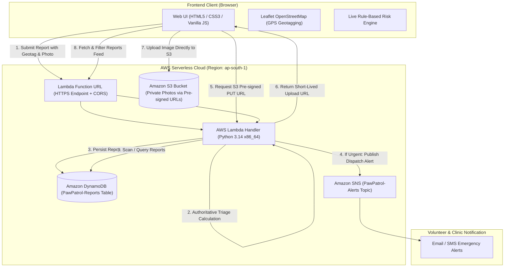

# 🐾 PawPatrol - Stray Animal Rescue & Emergency Dispatch Platform

**PawPatrol** is a full-stack, cloud-native stray animal rescue reporting and emergency coordination web application built for college engineering capstone presentation.

It provides citizens with an instant, geo-enabled reporting portal that automatically scores and classifies animal medical emergencies into triage risk tiers (`CRITICAL`, `HIGH`, `MEDIUM`, `LOW`), dispatches real-time alerts to animal shelters and volunteer squads, and persists all incident records in Amazon DynamoDB.

---

## 1. System Architecture



---

## 2. Rule-Based Triage & Risk Classification

PawPatrol features an intelligent, deterministic scoring engine implemented symmetrically in client-side JavaScript (for instantaneous UI feedback) and server-side Python (for authoritative database evaluation):

| Triage Tier | Score Threshold | Key Clinical Indicators | SLA Target | Automated Action |
| :--- | :--- | :--- | :--- | :--- |
| 🚨 **CRITICAL** | Score &ge; 12 | Unconscious / unresponsive, heavy arterial bleeding, hit-and-run impact with severe trauma | &lt; 30 mins | Immediate SNS email/SMS alert to emergency veterinary response teams |
| ⚠️ **HIGH** | Score 7 – 11 | Suspected limb fracture, rabies/neurological symptoms, trapped starving infant animals | &lt; 2 hours | Priority volunteer queue notification |
| 🩹 **MEDIUM** | Score 4 – 6 | Severe skin disease/mange, animal trapped in non-life-threatening ditch, open sores | &lt; 12 hours | Routine volunteer assessment visit |
| ✅ **LOW** | Score 1 – 3 | Healthy stray roaming safely, ABC (Animal Birth Control / Sterilization) request | &lt; 48 hours | Scheduled clinic checkup |

---

## 3. Project Directory Structure

```
PawPatrol/
├── .gitignore                   # Excludes credentials, venv, and local data
├── README.md                    # Project documentation & architecture
├── frontend/                    # Single-Page Web Application
│   ├── index.html               # Main application portal (Form, Dashboard, Map, SOPs)
│   ├── css/
│   │   └── style.css            # Responsive, emergency-themed modern CSS
│   └── js/
│       ├── app.js               # UI controller, live risk scoring, dashboard logic
│       ├── api.js               # Unified API client (Local server, AWS Cloud, Offline cache)
│       └── map.js               # Leaflet OpenStreetMap interactive pin & markers
├── backend/                     # Serverless & Local Backend Services
│   ├── lambda_function.py       # Production AWS Lambda handler (Python 3.14 x86_64)
│   ├── local_server.py          # Zero-dependency Windows local test server
│   ├── requirements.txt         # boto3 dependencies
│   └── test_backend.py          # Automated unit & integration tests
├── aws/                         # AWS Infrastructure & Deployment Assets
│   ├── dynamodb_schema.json     # Table definition (Pay-Per-Request Free Tier)
│   ├── lambda_policy.json       # Least-privilege IAM policy
│   ├── deploy_guide.md          # Step-by-step console and CLI deployment guide
│   └── mcp_setup.md             # AWS MCP Server configuration for Windows
└── data/                        # Local data directory for local server persistence
```

---


## 5. API Reference

### 1. `GET /reports` (or `/api/reports`)
Retrieves all rescue reports with optional query filters.

**Query Parameters:**
- `risk_level` (`CRITICAL` | `HIGH` | `MEDIUM` | `LOW`)
- `status` (`REPORTED` | `DISPATCHED` | `IN_TREATMENT` | `RESCUED` | `CLOSED`)
- `animal_type` (`Dog` | `Cat` | `Cattle` | `Bird` | `Other`)

**Response:**
```json
{
  "success": true,
  "count": 4,
  "reports": [
    {
      "report_id": "PAW-20261020-9E61C",
      "created_at": "2026-10-20T17:44:48Z",
      "updated_at": "2026-10-20T17:44:48Z",
      "status": "REPORTED",
      "animal_type": "Dog",
      "condition": "CRITICAL_INJURY",
      "risk_level": "CRITICAL",
      "risk_score": 19,
      "location_address": "Sector 18 Metro Gate 1, Noida",
      "latitude": 28.5700,
      "longitude": 77.3200
    }
  ]
}
```

### 2. `POST /reports`
Submits a new rescue incident report.

**Request Body:**
```json
{
  "animal_type": "Dog",
  "animal_age": "adult",
  "condition": "CRITICAL_INJURY",
  "symptoms": ["hit_by_vehicle", "bleeding_heavily"],
  "is_trapped": false,
  "description": "Puppy hit by vehicle, bleeding from hind leg.",
  "location_address": "Near Central Market Gate 2",
  "latitude": 28.6219,
  "longitude": 77.2150,
  "reporter_name": "Aarav Sharma",
  "reporter_phone": "+91 9811022334"
}
```

### 3. `PATCH /reports/{report_id}`
Updates case management status.

**Request Body:**
```json
{
  "status": "DISPATCHED"
}
```

### 4. `POST /upload-url`
Generates a pre-signed S3 PUT URL for secure, direct client-to-S3 photo upload.

---

## 6. AWS Cloud Deployment Summary

Please see [`aws/deploy_guide.md`](file:///C:/Users/stuti/.gemini/antigravity/scratch/PawPatrol/aws/deploy_guide.md) for the complete button-by-button AWS Console walkthrough.

1. **DynamoDB:** Create table `PawPatrol-Reports` with Partition Key `report_id` (String) and On-Demand billing.
2. **S3:** Create private bucket `pawpatrol-photos-<id>` with CORS enabled for direct PUT uploads.
3. **SNS:** Create Standard Topic `PawPatrol-Alerts` and subscribe your emergency email.
4. **Lambda:** Deploy `backend/lambda_function.py` with runtime `Python 3.14` on `x86_64` and enable Lambda Function URL with CORS.
5. **Connect:** Click the gear icon (⚙️) on the frontend web page and paste your Lambda Function URL.

---

## 7. Security & Free Tier Compliance

- **Zero Root Credential Risk:** No AWS passwords or root credentials are used or stored.
- **No Hardcoded Secrets:** AWS authentication is handled via IAM roles and standard credential profiles.
- **Private S3 Bucket:** Photos are uploaded and accessed via time-limited Pre-signed URLs without opening the bucket to public writes.
- **100% Free Tier Eligible:**
  - DynamoDB: On-Demand (Free within 25 GB limit).
  - Lambda: 1 Million free invocations per month.
  - S3: 5 GB free tier storage.
  - SNS: 1 Million free mobile/API publishes per month.
